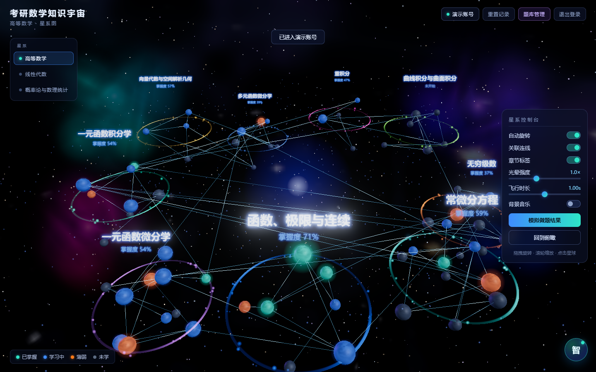
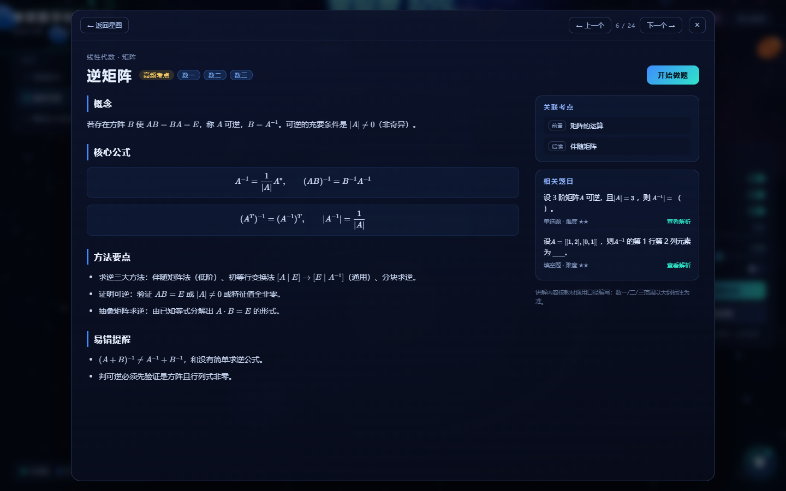
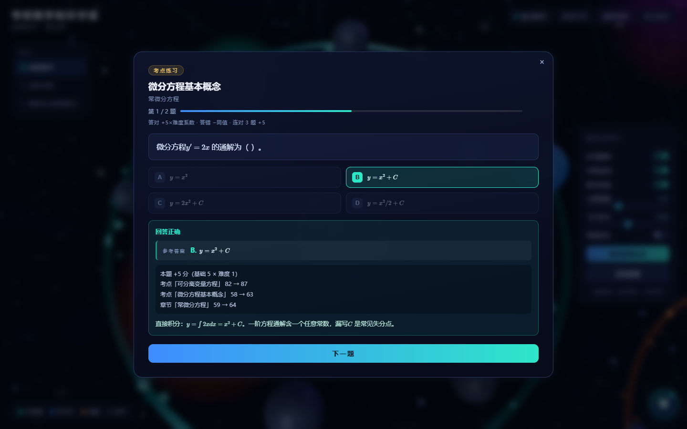
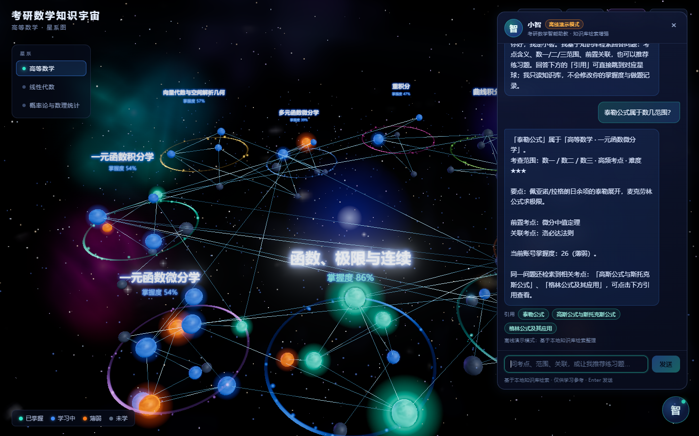
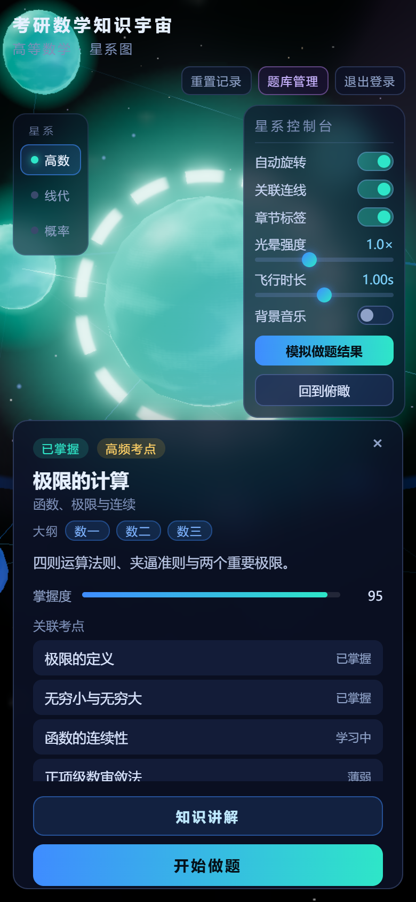

<div align="center">

# 考研数学知识宇宙

**把考研数学的 118 个考点，一步步搬进 3D 知识星系**

面向考研学生（数一 / 数二 / 数三）：在一个可旋转、可点击的星图里看懂知识结构、读讲解、做练习，实时看到自己的掌握度变化。


[](https://kaoyan-math-galaxy-5jmdkvkbn6k.qoder.zone)
[](docs/data-checklist.md)
[](https://img.shields.io/badge/%E6%9C%AC%E5%9C%B0%E8%BF%90%E8%A1%8C-npm%20run%20dev-c792ff?style=for-the-badge)

</div>



<table>
  <tr>
    <td width="50%"></td>
    <td width="50%"></td>
  </tr>
  <tr>
    <td align="center">知识讲解：Markdown + KaTeX 公式排版</td>
    <td align="center">练习：提交即结算，星球实时变色</td>
  </tr>
  <tr>
    <td width="50%"></td>
    <td width="50%"></td>
  </tr>
  <tr>
    <td align="center">小智：RAG 检索问答，引用可跳转考点</td>
    <td align="center">登录：演示账号一键进入 / 注册独立账号</td>
  </tr>
</table>

<p align="center"></p>
<p align="center">桌面与移动端均可完整使用</p>

## 这是什么

考研数学的知识点不是孤立的：一个考点的掌握，取决于它的前置知识。这个项目把 **章节做成星团、考点做成星球、前置与关联做成连线**，用颜色与亮度表示掌握度（已掌握 / 学习中 / 薄弱 / 未学）。点一下星球，就能看到考点简介、大纲范围、关联考点与知识讲解；做一组题，星球当场变亮或变暗。

- **3 个星系**：高等数学、线性代数、概率论与数理统计
- **21 个章节 · 118 个考点 · 163 条前置/关联 · 138 道练习**（单选 + 填空）
- **118 篇知识讲解**：概念、核心公式、方法要点、易错提醒，全部 Markdown + KaTeX 数学渲染
- **小智智能助教**：本地 RAG 检索 + 后端大模型代理（可选），回答附可点击的考点引用
- **完整学习闭环**：登录 / 注册 → 看星图 → 读讲解 → 做题 → 掌握度实时联动 → 记录按账号隔离
- **管理员工作台**：批量导入 CSV / Excel、逐题录入、AI 辅助检查（只建议，人工确认入库）
- **深空体验**：真实星野天穹、构图化星云、泛光与流光、程序化星空背景音乐

## 本地运行

无需后端即可体验（Node.js 18+）：

```bash
npm install
npm run dev
# 打开 http://localhost:5173 → 登录页点「直接进入演示账号」
```

生产构建 / 静态部署：

```bash
npm run build      # 输出 dist/
npx serve dist     # 或任意静态服务器
```

可选：开启在线 AI（小智问答 / 题目质检走后端代理，API Key 只在服务端）：

```bash
DEEPSEEK_API_KEY=sk-xxx node server/ai-proxy.mjs
# Vite 已把 /api 代理到 :8787；未启动时前端自动进入离线演示模式
```

质量检查：

```bash
npm run validate   # 数据 Schema + 引用完整性 + 公式可解析 + UI 泄漏守卫
npm run verify     # 120 项运行时验证（需先 npm run dev，并使用本机 Chrome）
```

> 在线体验地址为 Qoder Sites **私有**发布；若提示无权访问，请在站点设置中调整访问范围，或直接本地运行。

## 项目结构

```text
src/
  three/          3D 引擎（星系 / 星球 / 连线 / 星云背景 / 后处理 / 自适应画质）
  components/     React 界面（登录 / 知识讲解 / 考点练习 / 小智 / 题库工作台 / 控制台）
  data/           数据加载、RAG 检索、掌握度规则、用户表、Markdown+KaTeX 渲染
  audio/          程序化星空背景音乐（Web Audio，无音频文件）
public/
  data/           知识库 JSON、题库、关联、掌握度规则、118 篇 Markdown 讲解
  textures/       星野天穹贴图
server/           AI 后端代理（/api/ai/check、/api/ai/chat）与数据库 Schema
scripts/          数据校验、运行时验证
docs/             设计说明与答辩口径（数据清单 / 掌握度规则 / 视觉方案 / 部署等）
```

## 反馈与贡献

- **发现讲解或答案不对**：提一个 Issue，写上章节、题号或考点，以及你认为正确的答案和理由；
- **想补充考点 / 题目 / 功能**：先提 Issue 描述使用场景，再动手；
- **提交 Pull Request**：欢迎，请先看 `docs/` 里的数据口径与验证脚本，并保证 `npm run validate` 通过。

如果它帮到了你，欢迎点一个 ⭐ Star。

## 说明

- 章节与考点目录对照同济版教材与考研数学大纲原文整理；题目均为演示题并逐题人工验算。少量题目按公开教辅的题型结构**改写**（非逐字复制），相关权利归原作者，仅供学习交流。
- AI 只做建议：小智与质检不会写入掌握度或题库，管理员确认是唯一入库入口；在线 AI 的 API Key 只存在于后端进程。
- 账号、掌握度与做题记录保存在浏览器本地（localStorage），按账号隔离，不上传、不做第三方统计；未接后端时数据不跨设备同步。
- 除可选的 AI 代理外，所有功能均为本地静态资源，断网可完整演示。

## 许可

- **代码**：MIT（见 `LICENSE`）
- **讲解文字、题目与截图**：CC BY-NC 4.0（可转载、可改编，需署名，不得商用）
- 参考教辅改编的少量题目，其原始内容版权归原作者 / 出版社；如有异议请联系删除。
